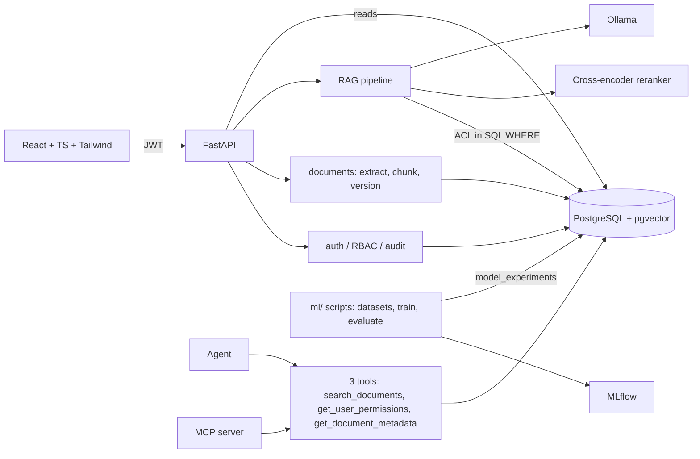
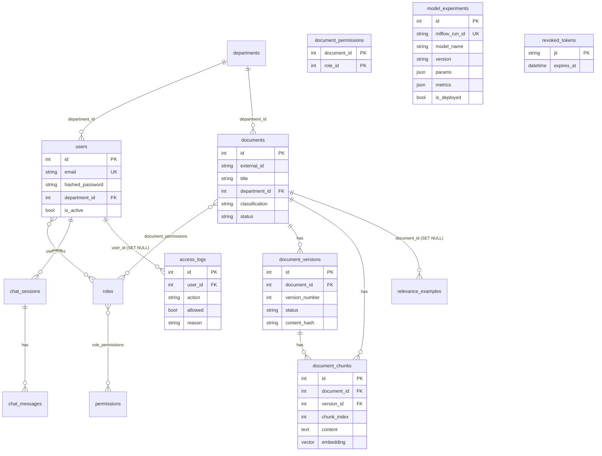

# Architecture



## Secure RAG sequence
```mermaid
sequenceDiagram
  participant U as User
  participant A as API
  participant D as PostgreSQL
  participant R as Reranker
  participant L as LLM
  U->>A: question + JWT
  A->>D: load identity (user, roles, permissions) — never from the client
  A->>D: vector search WHERE document ACTIVE AND role in document_permissions AND version ACTIVE
  D-->>A: authorized chunks only
  A->>R: rerank authorized candidates
  A->>L: system rules + <source> blocks (untrusted data) + question
  L-->>A: answer with [S#]
  A->>A: validate citations against provided sources; refuse if none
  A-->>U: answer + authorized citations
```

## Key design decisions
- **Deny by default.** Access = document `ACTIVE` ∧ user role ∈ `document_permissions`. Department alone grants nothing.
- **Filter inside the query.** `accessible_documents_clause()` is part of the SQL `WHERE` (before the pgvector `ORDER BY`), so unauthorized chunks are never read, ranked or sent to the LLM.
- **One active version.** Activating a version archives the previous one; retrieval joins `document_versions.status = 'ACTIVE'`.
- **Identity is server-side.** JWT carries only `sub`/`jti`; roles/permissions are reloaded from the DB on each request; tokens are revocable (logout) and users can be deactivated.
- **Indistinguishable denials.** Unauthorized and nonexistent documents/sessions both return 404 with the same body; denials are audited.
- **LLM is not a security boundary.** It never sees permissions or unauthorized text; citations are validated; answers without a valid citation are replaced by a refusal.
- **Tools get identity from the server.** Tool argument models forbid extra fields (no `user_id`/`role`); MCP over HTTP reads the Bearer token of the request, over stdio the server-process env `MCP_ACCESS_TOKEN`.
- **Agent** calls the same tool functions in-process (not through the MCP transport); the MCP server exposes them to external MCP clients.
- **Embeddings/reranker/LLM are configurable** via environment variables; `hash` embedder and `none` reranker exist only as explicit opt-ins for tests/offline demos.

## Database ER diagram

Constraints: unique `(document_id, version_number)`, unique `(version_id, chunk_index)`, CHECK on status/classification/split/role values, `ON DELETE CASCADE` from documents to versions/chunks/permissions, HNSW index `vector_cosine_ops` on `document_chunks.embedding` (PostgreSQL only, created by the Alembic migration).
