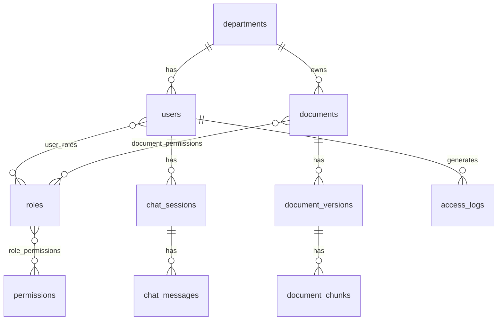

# Secure Enterprise Knowledge Assistant — Phase 1 (Foundation)

Phase 1 : structure du projet, schéma PostgreSQL/pgvector, authentification JWT, RBAC, ACL document-level, audit, seed et tests.
Les phases suivantes (datasets, ingestion, RAG, MCP, reranker, frontend…) ne sont **pas** encore implémentées.

## Démarrage rapide (Docker)
```bash
cp .env.example .env          # puis renseigner JWT_SECRET, POSTGRES_PASSWORD, SEED_PASSWORD
docker compose up --build -d  # applique les migrations Alembic puis lance l'API sur :8000
docker compose exec backend python -m app.database.seed
```
API : http://localhost:8000/docs — santé : `/health`, `/health/db`.

## Tests (sans Docker, SQLite temporaire)
```bash
cd backend && python -m venv .venv && source .venv/bin/activate
pip install -r requirements.txt && python -m pytest -q
```

## Utilisateurs de démo (domaine fictif `nordia-demo.com`, mot de passe = SEED_PASSWORD)
admin, ceo, hr.manager, hr.employee, it.manager, it.employee, finance.manager, finance.employee, employee.

## Modèle de sécurité (Phase 1)
- Identité reconstruite côté serveur à chaque requête depuis la base ; seuls `sub`/`jti` viennent du JWT. Rôle/département envoyés par le client sont ignorés.
- JWT HS256 avec algorithme figé (rejette `alg=none`), expiration, `jti` ; logout = révocation du `jti`.
- Mots de passe Argon2 ; message d'erreur identique pour email inconnu / mauvais mot de passe.
- Permissions par rôle (`require_permission`) ; refus journalisés dans `access_logs`.
- ACL document : **deny-by-default**. Accès ssi document `ACTIVE` et un rôle de l'utilisateur est dans `document_permissions`. `accessible_documents_clause()` (app/permissions/acl.py) est le filtre SQL destiné au retrieval pgvector (Phase 4).
- Rôle `SYSTEM_ADMIN` ajouté : gère utilisateurs/ACL mais ne lit les documents que s'il figure dans leur ACL.

## Limites connues
- Migration Alembic initiale validée sur SQLite uniquement ; elle n'a **pas** été exécutée sur PostgreSQL+pgvector dans cet environnement (extension `vector`, index HNSW). À vérifier avec `docker compose up`.
- Pas de rate limiting / verrouillage de compte sur `/login` (à ajouter avant production).
- Les contraintes de cycle de vie des documents (versioning, archivage à l'activation d'une nouvelle version) arrivent en Phase 3.

## ER (résumé)

